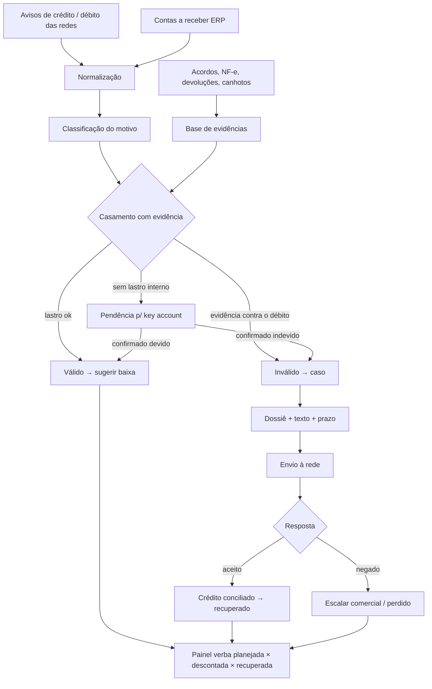
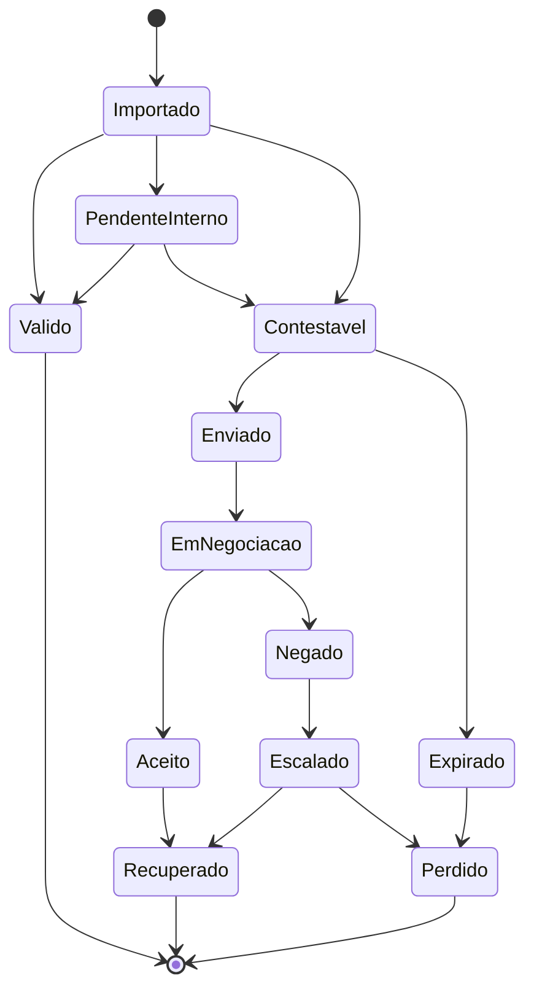
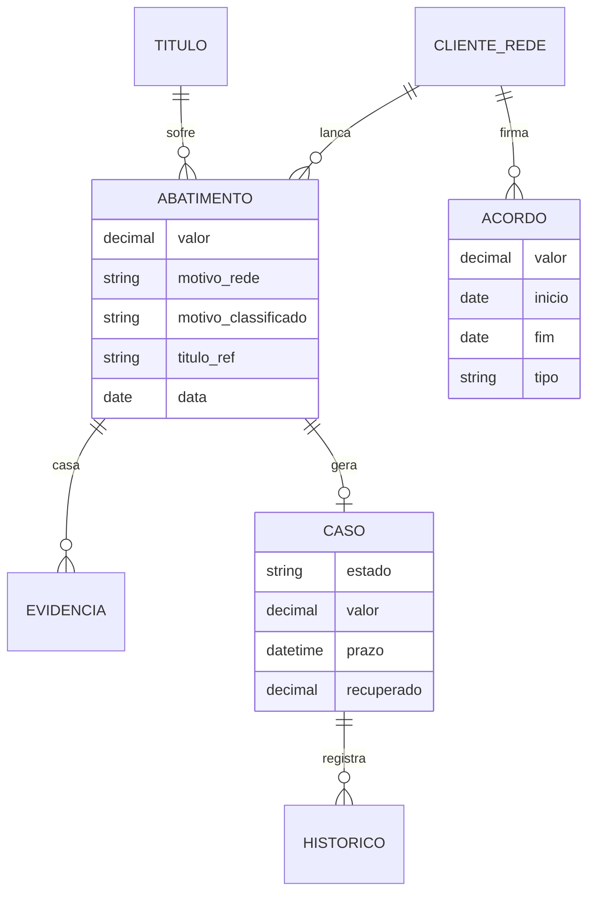

# Ideia 1: recuperação de deduções comerciais (indústria/distribuidor × varejo)

**Execução:** 29/10/2026, com o prompt `prompt-detalhamento-e-concorrentes-top4.md`.
**Legenda:** ✅ verificado (link) · 🟡 declarado pela empresa ou por terceiros · ❓ não verificado.

> **Limitações:** a busca no LinkedIn não foi possível (sem login, e o buscador ignora `site:linkedin.com`). A leitura direta de páginas está bloqueada pela política de rede da sessão, então usei apenas os trechos indexados pelo buscador. Detalhes em `ideia-4-delivery-conciliacao-contestacao.md`.

---

## 1. Resumo em 5 linhas

1. **Problema:** as redes de varejo pagam as duplicatas da indústria **já com abatimentos** (verbas, aniversário, ruptura, avaria, devolução, divergência de preço). Esses abatimentos aparecem em **Avisos de Crédito** gerados pela rede ✅ ([CreditoeCobranca](https://www.creditoecobranca.com/artigos/grandes-redes-verbas-e-abatimentos)). A indústria destina de 3% a 10% da receita a verbas, "na maioria das vezes sem controle" ✅ ([ABC da Comunicação](https://www.abcdacomunicacao.com.br/neogrid-anuncia-a-terceira-aquisicao-apos-seu-ipo/), [Brazil Journal](https://braziljournal.com/?p=74816)).
2. **Cliente:** indústrias e distribuidores de R$ 30–500M/ano que vendem para redes de supermercado, atacarejo e farmácia.
3. **Como funciona:** importa os avisos de crédito, débitos e extratos, os acordos comerciais e as NF-e/canhotos. Casa cada abatimento com a evidência, classifica como válido, inválido ou sem lastro, e gera o dossiê de contestação. Acompanha até o crédito.
4. **Onde está o espaço:** no Brasil, as ferramentas encontradas atuam **do lado do varejista** (Bluesoft, Sults, Renov Retail 🟡) ou no **planejamento** de verbas (Neogrid/Arker). Não encontrei nenhuma que atue **do lado do fornecedor contestando o abatimento**. Lá fora, a categoria levantou capital forte: Glimpse, Confido e **Stuut** (US$ 29,5M de Série A liderada pela a16z, nov/2025 ✅).
5. **Veredito:** **B, com espaço claro. Nota 7,7 (mantida).** É a primeira a validar.

---

## 2. Parte A: funcionamento e fluxo

### A1. Atores

| Ator | Papel |
|---|---|
| Gerente financeiro ou de crédito e cobrança da indústria | Comprador e usuário principal |
| Analista de contas a receber | Trata os abatimentos no dia a dia |
| Key account / gerente comercial | Detém os acordos; aprova o que é válido; aliado (quer verba "limpa") |
| Comprador e financeiro da rede (contraparte) | Lança os débitos; recebe e decide a contestação |
| Operador logístico / transportadora | Fonte de canhoto e comprovante de entrega |
| Diretoria | Quer o número "verba planejada × verba efetivamente descontada" |

### A2. Anatomia do problema

| Tipo de abatimento | Lastro esperado | Falha comum |
|---|---|---|
| Verba de acordo (aniversário, inauguração, enxoval, encarte, ponto extra) | Acordo assinado com valor e período (no varejo, há módulos de "acordo comercial" que geram débitos ao fornecedor ✅ ([Bluesoft](https://ajuda.bluesoft.com.br/modulo-de-compras/acordo-comercial/1243))) | Valor acima do acordado, duplicidade, cobrança fora do período |
| Ruptura, falta ou avaria | Canhoto sem ressalva, NF-e de devolução, laudo | Débito sem evidência; entrega comprovada |
| Divergência de preço | Tabela acordada × NF-e | Rede aplica preço antigo ou promocional |
| Devolução | NF-e de devolução + recebimento | Débito sem retorno físico |
| Multas logísticas (agendamento, palete, atraso) | Agendamento, registro de portaria | Multa sem prova do atraso |
| Rebate por volume | Volume real × faixa | Cálculo errado |

- **Evidência de mercado:** a Stuut cita um benchmark de 2025 segundo o qual empresas CPG de médio porte dos EUA baixam **1,2% a 2,4% da receita bruta** por deduções não recuperadas 🟡 ([Stuut](https://www.stuut.ai/blog/what-is-deduction-management-software)). No Brasil não há número equivalente ❓.
- **Natureza contábil e tributária:** bonificações e descontos são discutidos como redutores de custo; a jurisprudência oscila ✅ ([Migalhas](https://www.migalhas.com.br/depeso/372846/bonus-e-descontos-entre-o-varejista-e-seus-fornecedores)).
- **Prazos de contestação:** são definidos pelo contrato de fornecimento ou pelo manual de cada rede. Não encontrei regra pública ❓. É ponto-chave das entrevistas.

### A3. Jornada atual

1. A rede paga a duplicata com um valor menor.
2. O analista baixa o aviso de crédito (PDF, XLS ou portal) de cada rede.
3. Compara no Excel com o contas a receber.
4. Manda e-mail ao key account perguntando "essa verba foi acordada?".
5. Espera semanas.
6. Na falta de resposta, dá **baixa como desconto concedido**.

### A4. Fluxo do produto

1. **Onboarding:** redes clientes, layouts dos avisos de crédito, tipos de acordo e responsáveis.
2. **Importação:**
   - avisos de crédito e de débito (PDF, XLS, e-mail);
   - contas a receber do ERP (CSV ou API);
   - acordos (PDF, planilha);
   - XML de NF-e e de NF-e de devolução;
   - canhotos e comprovantes (Comprovei, TMS).
3. **Normalização:** um registro por abatimento (rede, loja, título, valor, código ou motivo, data).
4. **Classificação do motivo:** tabela por rede + LLM para textos livres.
5. **Casamento** com o acordo, a NF-e, a devolução, o canhoto e a tabela de preço.
6. **Decisão:** válido (sugerir baixa), inválido (contestar) ou sem lastro (pendência interna com SLA para o key account).
7. **Dossiê:** PDF com o abatimento, as evidências e a cláusula, mais o e-mail ou texto para o portal da rede.
8. **Acompanhamento:** prazo contratual, lembretes, status.
9. **Recuperação:** casar o crédito ou a nota reversa com o recebimento e dar baixa.
10. **Painel:** verba planejada × descontada × contestada × recuperada, por rede, motivo e key account.

### A5. Fontes de dados

| Fonte | Formato | Disponibilidade | Plano B |
|---|---|---|---|
| Aviso de crédito/débito da rede | PDF, XLS ou portal do fornecedor por rede; EDI (REMADV/DEBADV existem como padrão ✅ ([EDICOM](https://edicomgroup.com/br/blog/edi-varejo-mensagens-desadv-recadv)), mas o uso pelas redes brasileiras ❓) | Sem API pública | Upload ou encaminhamento de e-mail; **RPA nos portais só após a validação** e com credenciais do cliente |
| Contas a receber | ERP (TOTVS, SAP, Sankhya, Senior) | API ou CSV | Exportação CSV |
| NF-e e devoluções | XML | Arquivo do ERP ou distribuição DF-e da SEFAZ | Upload em lote |
| Canhotos e comprovantes | Imagem ou PDF (Comprovei, TMS) | Variável | Upload |
| Acordos | PDF assinado, planilha | Interno | Upload + extração por LLM |

**Sem integração fechada:** o MVP inteiro funciona com upload e e-mail.

### A6. Regras e uso de IA

- **Regras determinísticas:**
  - verba debitada sem acordo, ou valor maior que o acordado, ou fora do período → contestável;
  - débito de falta com canhoto sem ressalva → contestável;
  - preço NF-e = tabela acordada e débito de divergência de preço → contestável;
  - mesmo débito duas vezes (rede, valor, referência) → duplicidade.
- **IA:**
  - extrair dados de avisos de crédito em PDF, cujo layout varia por rede;
  - extrair valor, período e escopo dos acordos;
  - classificar motivos em texto livre;
  - redigir a contestação.

### A7. Modelo de dados

### A8. Telas (6)

1. Importação (arraste PDF/XLS por rede).
2. Abatimentos do mês (filtros por rede e motivo).
3. Pendências internas (fila do key account).
4. Casos contestáveis com prazo.
5. Dossiê.
6. Painel de verba planejada × descontada × recuperada.

### A9. Riscos

- **Técnicos:** layouts heterogêneos por rede; volume de PDFs.
- **Comerciais:**
  - medo de atrito com a rede (posicionar como "organização de evidência", contestando só o claramente indevido);
  - ciclo de venda de 30–90 dias.
- **Jurídicos:** contestação administrativa não exige advogado. Credenciais de portais exigem cofre e consentimento. LGPD tem impacto baixo (dados B2B).
- **Operacionais:** no início, o fundador faz parte da análise (concierge).

### A10. MVP (60 dias) e métricas

- **Entra:** upload de avisos de 3 redes, XML de NF-e, acordos em planilha, 4 regras, dossiê em PDF, painel.
- **Fora:** RPA, integração com ERP, EDI.
- **Métrica primária:** R$ contestável identificado e R$ recuperado.
- **Sucesso:** 3 diagnósticos pagos; 2 convertidos para assinatura; recuperado ≥ 5× o preço.

---

## 3. Parte B: concorrentes

### B1. Log de buscas

| # | Consulta | Resultado |
|---|---|---|
| 1 | débitos comerciais + portal do fornecedor + contestação | ✅ Bluesoft (acordo comercial do lado do varejo), Migalhas, CreditoeCobranca (avisos de crédito) |
| 2 | "gestão de verbas" / "gestão de deduções" fornecedor | ✅ Sankhya (verbas), Renov Retail "Conciliador de Verbas" 🟡 (varejo), Sults (varejo) |
| 3 | Arker/Neogrid: funcionalidades | ✅ TPM: planejamento, distribuição, efetividade e comprovação de execução (2021). Contestação de débito ❓ |
| 4 | Consultoria de recuperação de verbas por êxito | Vazio (só recuperação tributária) |
| 5 | EDI: aviso de débito no varejo | ✅ padrões DESADV, RECADV, REMADV e DEBADV; uso no Brasil ❓ |
| 6 | "aviso de crédito" + automação contas a receber | ✅ HighRadius, SAP Cash App (globais); nada brasileiro |
| 7 | Stuut: funding | ✅ US$ 29,5M de Série A (a16z), nov/2025; Série B de US$ 52,5M 🟡 |
| 8 | Renov Retail | Vazio: existência não confirmada |
| 9 | Automação de contas a receber B2B no Brasil | ✅ Neofin (cobrança com IA), Asaas/NexInvoice; nada de deduções |
| 10–12 | `site:linkedin.com` (empresas, posts, vagas) | **Operador ignorado** pelo buscador |

### B2. Fichas

| Concorrente | Tipo / lado | Faz | Não faz | Confiança |
|---|---|---|---|---|
| **Neogrid / Arker** ([Baguete](https://www.baguete.com.br/noticias/neogrid-compra-arker-por-r-26-milhoes), [Mercado & Consumo](https://mercadoeconsumo.com.br/25/08/2021/noticias/solucoes-de-trade-promotion-management-ganham-forca-na-industria-e-no-varejo-brasileiros/)) | TPM, indústria | Planejamento orçamentário, distribuição de verbas, análise de efetividade, comprovação de execução ✅ | Captura do aviso de crédito, casamento com NF-e/canhoto e contestação ❓ (sem evidência) | Média |
| **Bluesoft** ([ajuda](https://ajuda.bluesoft.com.br/modulo-de-compras/acordo-comercial/1243)) | ERP de varejo, **lado da rede** | Gera débitos de acordo comercial ao fornecedor ✅ | É a ferramenta da contraparte | Alta |
| **Sults** ([página](https://www.sults.com.br/solucoes/gestao/4-melhores-sistemas-supermercado)) | Varejo | "Reconciliação de deduções e verbas cooperadas" 🟡 | Lado da rede | Baixa |
| **Renov Retail** ([página](https://www.renovretail.com.br/produto/gestao-de-verbas/)) | Varejo | "Conciliador de Verbas" 🟡 | Lado da rede; existência não confirmada em outras fontes | Baixa |
| **Sankhya** ([página](https://www.sankhya.com.br/gestao-de-negocios/gestao-de-verbas-comerciais/)) | ERP (distribuidores) | Controle de verbas recebidas de fornecedores 🟡 | Contestação de abatimentos da rede ❓ | Baixa |
| **HighRadius** ([deductions](https://www.highradius.com/resources/platform/deductions-management/)) | Global, enterprise | Deduções, envio a portais, notas de crédito ✅ | Presença e preço no Brasil ❓; fora do alcance do mid-market | Média |
| **SAP / TOTVS** (módulos de contas a receber) | ERP | Conciliação de recebimentos ✅ (SAP Cash App) | Contestação específica ❓ | Média |
| **Neofin** ([Contábeis](https://www.contabeis.com.br/noticias/76936/automacao-de-contas-a-receber-como-a-neofin-utiliza-ia-para-gestao-de-cobranca-das-empresas/)) | Contas a receber/cobrança com IA, Brasil | Cobrança inteligente ✅ | Deduções comerciais ❌ | Média |
| **BPOs financeiros / consultorias de trade** | Serviço | Tratamento manual 🟡 | Escala | Baixa |
| **Referências estrangeiras:** Glimpse, Confido, Stuut ([PYMNTS](https://www.pymnts.com/news/fintech-investments/2025/stuut-raises-29-million-dollars-ai-powered-accounts-receivable-automation-platform/)) | EUA | Agentes de dedução ✅ | Presença no Brasil: nenhuma encontrada | — |

### B3. Matriz de sobreposição

Etapas: **1** importação de avisos · **2** normalização/classificação · **3** casamento com evidência · **4** decisão · **5** dossiê · **6** acompanhamento com prazo · **7** recuperação/baixa · **8** painel planejado × descontado.

| | 1 | 2 | 3 | 4 | 5 | 6 | 7 | 8 |
|---|:-:|:-:|:-:|:-:|:-:|:-:|:-:|:-:|
| Neogrid/Arker | ❓ | ❓ | ◐ (execução) | ❌ | ❌ | ❌ | ❌ | ◐ |
| Bluesoft / Sults / Renov (rede) | n/a | n/a | n/a | n/a | n/a | n/a | n/a | n/a |
| Sankhya | ❓ | ◐ | ❓ | ❌ | ❌ | ❌ | ◐ | ◐ |
| SAP / TOTVS contas a receber | ◐ | ◐ | ❌ | ❌ | ❌ | ❌ | ✅ | ❌ |
| HighRadius (global) | ✅ | ✅ | ✅ | ✅ | ✅ | ✅ | ✅ | ◐ |
| **Proposta** | ✅ | ✅ | ✅ | ✅ | ✅ | ✅ | ✅ | ✅ |

### B4. Reclassificação

- **B, confiança média.** Nenhum player brasileiro atende o **fornecedor de médio porte na contestação**. O único que cobre o fluxo completo é o HighRadius, enterprise e global.
- **Ameaças:**
  - Neogrid/Arker adicionar contestação ao TPM;
  - HighRadius descer para o mid-market;
  - Stuut ou Glimpse entrarem na América Latina.
- **Risco de a contraparte resolver:** baixo, porque a rede não tem incentivo para facilitar a contestação.
- **Não verificado:** prazos contratuais de contestação por rede; uso de EDI para débitos; consultorias de recuperação de verbas por êxito; funcionalidades atuais da Arker.

---

## 4. Riscos e perguntas para entrevistas

**Riscos:**
1. Ciclo de venda longo.
2. Medo de atrito com a rede.
3. Layouts de PDF heterogêneos.
4. Dependência do key account para validar acordos.

**10 perguntas:**
1. Quanto as redes abateram das suas duplicatas nos últimos 6 meses, em R$ e em % da receita?
2. Quantas pessoas e horas por semana tratam esses abatimentos?
3. Que % você consegue explicar com um acordo assinado?
4. Qual foi o último abatimento indevido que você recuperou? Quanto tempo levou?
5. Qual o prazo contratual para contestar em cada rede? Já perdeu algum?
6. Onde estão os acordos hoje (PDF, e-mail, CRM, cabeça do vendedor)?
7. Como você recebe o aviso de crédito de cada rede (portal, e-mail, EDI)?
8. Usa Arker, Neogrid, HighRadius ou BPO para isso? O que falta?
9. Pagaria R$ 2.500/mês + 10% do recuperado? Ou preferiria 15–20% só sobre o êxito?
10. Me envia 3 meses de avisos de crédito de 2 redes para um diagnóstico esta semana? *(Teste de compromisso real.)*
