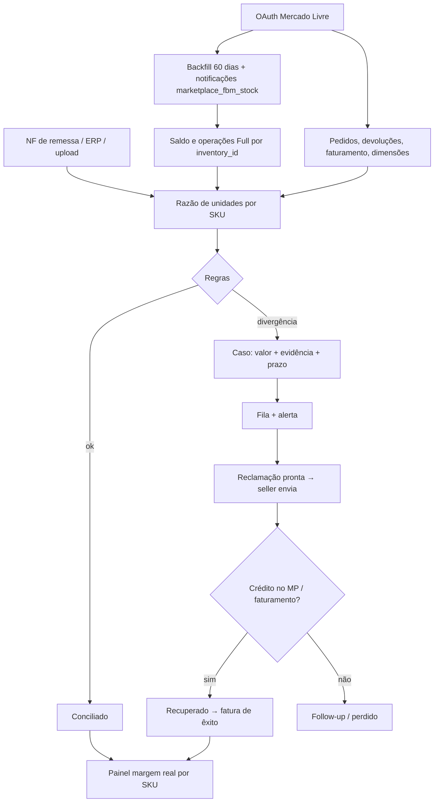
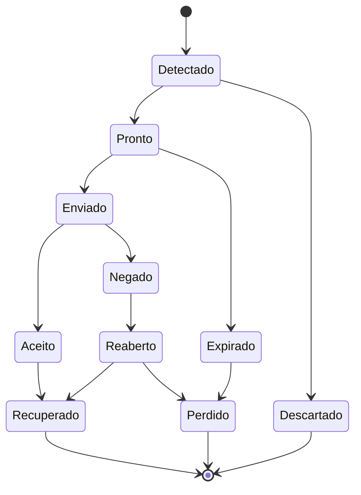

# Ideia 2: auditoria e recuperação de perdas em marketplaces (ML Full, Shopee, Amazon BR)

**Execução:** 29/10/2026, com o prompt `prompt-detalhamento-e-concorrentes-top4.md`.
**Legenda:** ✅ verificado · 🟡 declarado pela empresa ou por terceiros · ❓ não verificado.

> **Limitações:** a busca no LinkedIn não foi possível (sem login, e o buscador ignora `site:linkedin.com`). A leitura direta de páginas está bloqueada pela política de rede da sessão, então usei apenas os trechos indexados pelo buscador.

---

## 1. Resumo em 5 linhas

1. **Problema:** sellers no Full perdem dinheiro com:
   - estoque perdido ou avariado no centro de distribuição (o ML indeniza pelo Programa de Proteção Full ✅ ([ML](https://global-selling.mercadolibre.com/help/23703)));
   - devoluções revisadas contra o seller;
   - tarifas e fretes divergentes;
   - armazenagem cobrada sobre unidades que a plataforma não localiza 🟡 ([Mercado Advogados](https://www.mercadoadvogados.com.br/conteudo/produto-sumiu-full-mercado-livre)).

   O modelo de tarifas do Full passou a ser variável em 02/03/2026 🟡 ([GoSmarter](https://gosmarter.com.br/mercado-envios-full-vale-a-pena-2026-2/)), o que aumenta a complexidade.
2. **Cliente:** sellers profissionais (R$ 100 mil a R$ 5M/mês) com estoque no Full.
3. **Como funciona:** OAuth na API do ML → estoque Full + **histórico de operações** (`/stock/fulfillment/operations/search`) + pedidos, devoluções e faturamento → regras de detecção → fila de reclamações com evidência → acompanhamento até o crédito → cobrança sobre o êxito.
4. **Onde está o espaço:** Koncili, TrackCash e Equals conciliam repasse; Hunter Hub e SellerFiscal auditam taxas e margem; escritórios cobram judicialmente. **Ninguém encontrado reconstrói o razão de unidades do Full** (enviado → recebido → vendido → devolvido → saldo) para gerar reclamações.
5. **Veredito:** **B. Nota de 7,5 para 7,4.** A Amazon BR já reembolsa automaticamente e passou a reembolsar pelo custo 🟡, o que reduz a atratividade do canal Amazon. O foco deve ser o ML Full.

---

## 2. Parte A: funcionamento e fluxo

### A1. Atores

- **Dono ou gestor do e-commerce:** paga.
- **Analista de marketplace ou financeiro:** usa no dia a dia.
- **Mercado Livre, Shopee, Amazon:** contrapartes; decidem reclamações.
- **ERP ou hub (Bling, Tiny, UpSeller):** fonte de custo e NF-e.
- **Contador:** recebe a conciliação.

### A2. Anatomia do problema

| Perda | Regra / evidência | Prazo de reclamação |
|---|---|---|
| Unidade enviada ao Full e não registrada como recebida | Inbound (NF de remessa) × operação de entrada | ❓ "a demora pode fazer perder o direito" 🟡 ([GoSmarter](https://gosmarter.com.br/indenizacao-mercado-livre-vendedor/)) |
| Unidade perdida ou avariada no CD | Operações de ajuste negativas sem venda | ❓ (Programa de Proteção Full) |
| Devolução revisada contra o seller | Revisão física em até 3 dias úteis; o seller **pode contestar em até 60 dias** 🟡 ([GoBots](https://gobots.ai/blog/devolucao-full-mercado-livre-como-funciona-a-revisao-e-como-proteger-sua-margem/)) | 60 dias 🟡 |
| Devolução com tarifa e frete não estornados | Comparar o relatório de Faturamento por venda 🟡 ([Hunter Hub](https://hunterhub.com.br/blog/auditar-taxas-divergentes-2026-passo-a-passo/)) | ❓ |
| Armazenagem sobre unidades não localizadas | Saldo × armazenagem cobrada 🟡 | ❓ |
| Tarifa ou frete acima do devido | Tabela da categoria e peso cadastrado × cobrado | ❓ |
| **Amazon BR (FBA)** | Reembolso automático desde nov/2024; base de custo desde nov/2025; prazos de 60 dias a 18 meses 🟡 ([SalesDuo](https://salesduo.com/blog/amazon-fba-reimbursement-claims-guide-brazil/)) | Varia |

### A3. Jornada atual

1. O seller olha o saldo do Full no painel.
2. Percebe a falta só no inventário ou na venda sem estoque.
3. Abre chamado no atendimento sem dados estruturados.
4. Desiste ou perde o prazo.
5. Alguns contratam advogado ([Mercado Advogados](https://www.mercadoadvogados.com.br/conteudo/cobranca-indevida-mercado-livre)).

### A4. Fluxo do produto

1. **OAuth** com o ML (app registrado no DevCenter).
2. **Backfill de 60 dias**, que é o máximo por consulta de operações ✅ ([docs ML](https://developers.mercadolibre.cl/en_us/fulfillment)). Depois, **assinatura do tópico de notificações de estoque Full** (`marketplace_fbm_stock` ✅) para operar em tempo real.
3. **Para cada `inventory_id`:**
   - saldo (`GET /inventories/{id}/stock/fulfillment`: total, disponível, não disponível ✅);
   - operações (`GET /stock/fulfillment/operations/search` ✅).
4. **Importação** de pedidos, devoluções/claims, faturamento (tarifas e fretes) e dimensões dos anúncios.
5. **Razão de unidades por SKU:** enviado (NF de remessa, upload ou ERP) → recebido → vendido → devolvido → ajustes → saldo esperado × saldo real.
6. **Regras de detecção** (seção A6) → casos com valor estimado (custo ou preço, conforme a regra do programa) e prazo.
7. **Fila priorizada + alerta.**
8. **Reclamação:** texto, planilha de evidência e passo a passo. O envio é manual pelo seller; a API de reclamação de seller ❓ não foi verificada.
9. **Acompanhamento:** identificar o crédito no Mercado Pago ou no relatório de faturamento → marcar como recuperado → faturar o êxito.
10. **Painel:** perdas por tipo, recuperado e margem real por SKU.

### A5. Fontes

| Fonte | Status |
|---|---|
| ML: estoque e operações do Full | ✅ API documentada; somente leitura; janela de 60 dias; padrão de 15 dias ([docs](https://developers.mercadolivre.com.br/pt-br/envios-fulfillment)) |
| ML: notificações | ✅ tópico de operações de estoque FBM |
| ML: pedidos, claims, faturamento | API pública 🟡 (endpoints específicos de faturamento ❓) |
| Shopee Open Platform | ❓ não verificado nesta execução |
| Amazon SP-API (BR) | 🟡 reembolso já automático; prioridade baixa |
| NF de remessa ao Full | ERP (Bling, Tiny) ou upload |

**Sem integração fechada:** sim. A API do ML é pública via OAuth.

### A6. Regras e uso de IA

| Regra | Lógica |
|---|---|
| Recebimento a menor | Unidades da NF de remessa > operação de entrada |
| Perda no CD | Ajuste negativo sem venda/devolução, ou saldo real < saldo esperado |
| Devolução não reintegrada | Devolução concluída sem operação de reingresso e sem reembolso ao seller após X dias |
| Tarifa não estornada | Venda cancelada/devolvida com tarifa ou frete ainda debitados |
| Frete acima do devido | Peso/dimensão cobrada > cadastrada (com tolerância) |
| Armazenagem indevida | Armazenagem cobrada sobre unidade marcada como perdida |

**IA:** só na redação da reclamação e na classificação de motivos de devolução. O núcleo é determinístico.

### A7. Modelo de dados

`SELLER` → `SKU/INVENTORY` → `OPERACAO_FULL` (tipo, quantidade, data) · `PEDIDO` · `DEVOLUCAO` · `LANCAMENTO_FATURAMENTO` → `CASO` (regra, unidades, valor, prazo, estado) → `EVIDENCIA`.

### A8. Telas (6)

1. Conectar o ML.
2. Razão de unidades por SKU.
3. Fila de casos.
4. Detalhe e reclamação.
5. Recuperado e fatura.
6. Margem real por SKU.

### A9. Riscos

- **Plataforma:** o ML pode automatizar indenizações (como fez a Amazon) ou restringir apps. A janela de 60 dias exige sincronização contínua.
- **Prazos:** os prazos do programa não são públicos ❓.
- **Jurídico:** termos de uso do DevCenter; não usar RPA no painel.
- **Comercial:** churn alto se o valor recuperado cair após a limpeza inicial. Mitigação: incluir monitoramento contínuo + margem por SKU.

### A10. MVP (30–45 dias)

- **Entra:** ML apenas; 4 regras (recebimento a menor, perda no CD, devolução não reintegrada, tarifa não estornada); fila; reclamação pronta; marcação manual.
- **Métrica primária:** R$ recuperado por seller por mês.
- **Sucesso:** 10 auditorias gratuitas → 5 com mais de R$ 1.000 recuperáveis → 3 pagantes.

---

## 3. Parte B: concorrentes

### B1. Log de buscas

| # | Consulta | Resultado |
|---|---|---|
| 1 | API do ML: estoque e operações do Full | ✅ endpoints documentados |
| 2 | Indenização de produto perdido no Full: prazo | ✅ guias de terceiros; regras oficiais ❓ |
| 3 | Ferramentas de auditoria do Full (Magis5, Hub2b, Real Trends, Nubimetrics, Ideris) | Vazio para auditoria do Full; ✅ UpSeller (devoluções), Jaguar Sheet (estoque multi-conta) |
| 4 | Amazon BR: reembolso FBA | ✅ SalesDuo (guia BR), reembolso automático desde nov/2024 🟡 |
| 5 | Recuperação de valores ML: Full, devoluções, tarifas | ✅ Hunter Hub (auditoria de tarifas), Mercado Advogados, GoBots (devolução Full), Terazi, Cargoos |
| 6 | Hunter Hub | Vazio sobre o produto; ✅ SellerFiscal (P&L por venda ML/Shopee) |
| 7 | GoBots | ✅ IA de atendimento para marketplaces (Campinas, 2016) |
| 8 | SalesDuo no Brasil | ✅ guia BR; serviço com preço local ❓ |
| 9 | ML: reembolso automático do Full em 2026 | Vazio; ✅ mudança tarifária de 02/03/2026 🟡 |
| — | Primeira pesquisa: Koncili, TrackCash, Equals, Base | ✅ conciliação de repasse |
| — | `site:linkedin.com` | **Operador ignorado** |

### B2. Fichas

| Concorrente | Faz | Não faz | Confiança |
|---|---|---|---|
| **Koncili** ([site](https://www.koncili.com/?p=4034)) | Conciliação de repasses em ML, Amazon, Magalu, Shopee e outros ✅ | Razão de unidades do Full; reclamações ❓ | Média |
| **TrackCash + Bling** ([blog](https://blog.bling.com.br/bling-e-trackcash-conciliacao-das-vendas-em-marketplaces/)) | Conciliação pedido → repasse ✅ | Idem | Média |
| **Equals, GeFinance, Boa Vista View** ([comparativo](https://marketplace.anymarket.com.br/conciliacao-financeira-marketplace-comparativo/)) | Conciliação financeira ✅ | Idem | Média |
| **Hunter Hub** ([blog](https://hunterhub.com.br/blog/auditar-taxas-divergentes-2026-passo-a-passo/)) | Conteúdo + ferramenta de **auditoria de taxas** (compara comissão com a mediana do anúncio) 🟡 | Estoque Full ❓; êxito ❓ | Baixa: **concorrente mais próximo; investigar** |
| **SellerFiscal** ([Product Hunt](https://www.producthunt.com/products/sellerfiscal/reviews)) | Upload de relatório ML/Shopee → P&L por venda; "auditoria fiscal" 🟡 | Recuperação ❌ | Baixa |
| **Jaguar Sheet** ([blog](https://jaguarsheet.com/pt/blog/centralizar-inventario-multi-cuenta)) | Inventário multi-conta ML 🟡 | Reclamações ❓ | Baixa |
| **UpSeller** ([ajuda](https://upseller.com/pt/help-doc-article-532)) | Controle de reclamações e devoluções ML ✅ | Razão do Full; êxito | Média |
| **GoBots** ([blog](https://gobots.ai/blog/devolucao-full-mercado-livre-como-funciona-a-revisao-e-como-proteger-sua-margem/)) | IA de atendimento ao comprador; conteúdo sobre devolução Full ✅ | Recuperação ❓ | Média |
| **Mercado Advogados** ([conteúdo](https://www.mercadoadvogados.com.br/conteudo/produto-sumiu-full-mercado-livre)) | Cobrança judicial/administrativa de estoque sumido e tarifas ✅ | Software, escala | Alta (substituto e possível parceiro) |
| **SalesDuo** ([guia BR](https://salesduo.com/blog/amazon-fba-reimbursement-claims-guide-brazil/)) | Reembolsos FBA, incluindo Amazon.com.br 🟡 | ML ❌ | Média |
| **GETIDA / Carbon6** | Reembolso FBA a ~25% ✅ (EUA) | ML ❌ | — |

### B3. Matriz

Etapas: **1** OAuth/ingestão · **2** razão de unidades do Full · **3** detecção de perdas · **4** auditoria de tarifas e fretes · **5** reclamação pronta com prazo · **6** acompanhamento até o crédito · **7** margem por SKU · **8** cobrança por êxito.

| | 1 | 2 | 3 | 4 | 5 | 6 | 7 | 8 |
|---|:-:|:-:|:-:|:-:|:-:|:-:|:-:|:-:|
| Koncili / TrackCash / Equals | ✅ | ❌ | ❌ | ◐ | ❌ | ◐ | ◐ | ❌ |
| Hunter Hub | ◐ | ❓ | ❓ | ✅🟡 | ❓ | ❓ | ❓ | ❓ |
| SellerFiscal | ◐ (upload) | ❌ | ❌ | ◐ | ❌ | ❌ | ✅ | ❌ |
| UpSeller | ✅ | ❌ | ❌ | ❌ | ◐ | ❌ | ◐ | ❌ |
| Mercado Advogados | ❌ | ❌ | ◐ (manual) | ◐ | ✅ | ✅ | ❌ | ✅ |
| **Proposta** | ✅ | ✅ | ✅ | ✅ | ✅ | ✅ | ✅ | ✅ |

### B4. Reclassificação

- **B, confiança média.** O espaço está nas **etapas 2 e 3** (razão de unidades do Full e detecção de perdas), em que ninguém tem ✅.
- **Ameaças:**
  - Hunter Hub expandir para o Full;
  - Koncili adicionar auditoria de estoque;
  - **o ML automatizar indenizações**.
- **Não verificado:** prazos oficiais do Programa de Proteção Full; API de claims de seller; Shopee; produto real do Hunter Hub; Magis5, Hub2b, Ideris, Real Trends e Nubimetrics.

---

## 4. Riscos e perguntas para entrevistas

**Riscos:**
1. Mudança de política do ML.
2. Churn após a "limpeza" inicial.
3. Seller pequeno com valor recuperado baixo.

**10 perguntas:**
1. Quantas unidades você tem no Full? Já fez inventário e encontrou divergência? De quanto?
2. Já pediu indenização ao Programa de Proteção Full? Quantas vezes, e quanto recebeu?
3. Já perdeu prazo de reclamação ou de contestação de devolução?
4. Quanto paga de armazenagem por mês? Confere se é sobre unidades que existem?
5. Confere tarifa e frete por venda? Com qual ferramenta?
6. Usa Koncili, TrackCash, Hunter Hub ou outra? O que ela não pega?
7. Quem faz isso hoje, e quantas horas por mês leva?
8. Pagaria 20% do recuperado? Ou R$ 149–399/mês + 15%?
9. Venderia também na Shopee e na Amazon com o mesmo problema?
10. Autoriza a auditoria gratuita dos últimos 60 dias agora? *(Teste de compromisso real.)*
