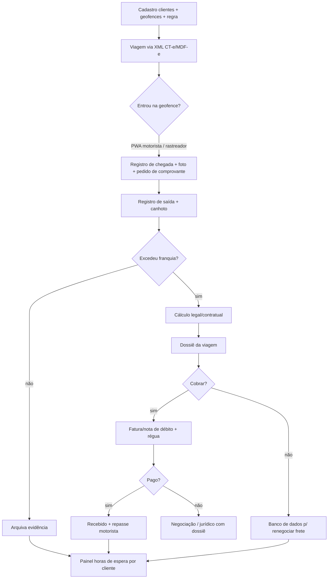
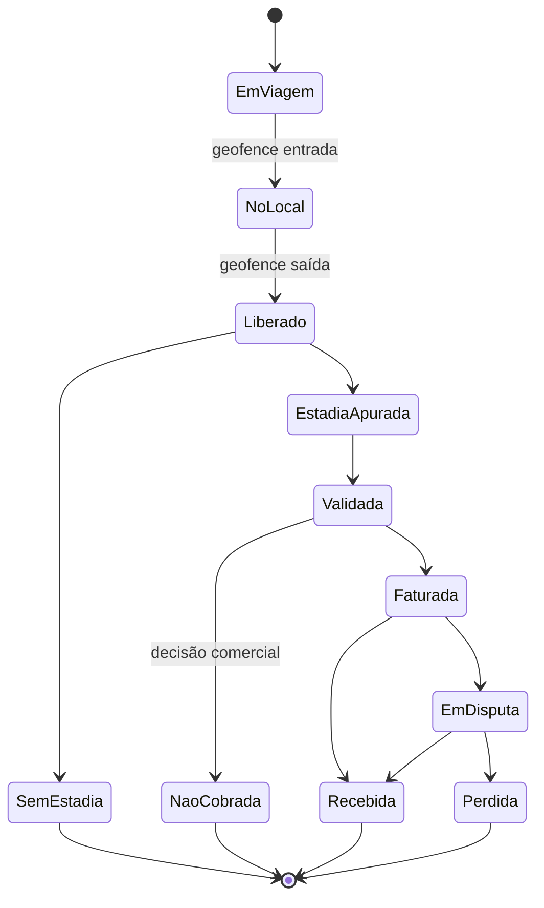

# Ideia 3: registro, prova e cobrança de estadia para transportadoras

**Execução:** 29/10/2026, com o prompt `prompt-detalhamento-e-concorrentes-top4.md`.
**Legenda:** ✅ verificado · 🟡 declarado pela empresa ou por terceiros · ❓ não verificado.

> **Limitações:** a busca no LinkedIn não foi possível (sem login, e o buscador ignora `site:linkedin.com`). A leitura direta de páginas está bloqueada pela política de rede da sessão, então usei apenas os trechos indexados pelo buscador.

---

## 1. Resumo em 5 linhas

1. **Problema:** a Lei 11.442/2007 garante indenização por estadia após **5 horas** de carga ou descarga, mas o **ônus da prova é do transportador**. Os tribunais pedem rastreamento, GPS ou testemunhas, e há divergência sobre a exigência de aviso prévio da chegada ✅ ([Legjur TJPR/TJMT](https://www.legjur.com/jurisprudencia/eme/760.8542.9824.2500)).
2. **Valor vigente:** **R$ 2,50 por tonelada/hora** desde abril/2026 (Nota Técnica ANTT 4102/2026). O embarcador ou destinatário que **não fornece o comprovante de chegada** pode ser multado em até **5% do valor da carga** ✅ ([Mundo Logística](https://mundologistica.com.br/noticias/antt-reajusta-estadia-tempo-adicional-carga-descarga), [ANTT](https://www.gov.br/antt/pt-br/assuntos/cargas/carga-descarga/sei_41736493_nota_tecnica___antt_4102.pdf)).
3. **Cliente:** transportadoras de lotação, granel e porto com 20–300 veículos que **não** usam TMS de grande porte.
4. **Como funciona:** check-in e check-out por geofence (PWA do motorista e/ou rastreador) + foto e assinatura da portaria → cálculo legal ou contratual → dossiê por viagem → fatura de estadia vinculada ao CT-e → cobrança.
5. **Veredito:** **de A/D para B.** O **TOTVS TMS já classifica estadia e gera a cobrança automaticamente** ✅ ([TOTVS](https://produtos.totvs.com/ficha-tecnica/tudo-sobre-o-totvs-logistica-tms/)), e o Comprovei registra comprovação de entrega. A lacuna é a **captura da prova independente do embarcador** e o **dossiê** para transportadoras médias. **Nota de 7,3 para 7,0.**

---

## 2. Parte A: funcionamento e fluxo

### A1. Atores

| Ator | Papel |
|---|---|
| Dono, gerente comercial ou financeiro da transportadora | Paga e decide cobrar ou usar como argumento de negociação |
| Programador ou gestor de tráfego | Usuário diário |
| Motorista (frota própria, agregado ou TAC) | Faz o check-in; recebe parte da estadia |
| Embarcador e destinatário | Contrapartes; **dever legal de registrar a chegada**; responsabilidade solidária |
| Rastreador / gerenciadora de risco | Fonte de GPS |
| TMS / emissor de CT-e | Viagem e faturamento |

### A2. Anatomia do problema

- **Cálculo:** (horas totais − 5 h) × R$ 2,50 × capacidade em toneladas.
  - Exemplo: 30 t × 4 h excedentes × R$ 2,50 = **R$ 300 por ocorrência**.
  - Frota de 50 caminhões com 40 ocorrências/mês de 4 h → **cerca de R$ 12 mil/mês** potenciais. (**Estimativa:** a frequência é premissa ❓.)
- **Por que não cobram:**
  - falta prova;
  - medo de perder o cliente;
  - processo manual;
  - divergência jurisprudencial sobre aviso prévio.
- **Prescrição:** um caso do TJPR aplicou o prazo de 5 anos ✅ ([Legjur](https://www.admdireito.com.br/jurisprudencia/eme/618.6128.4382.9029)), o que permite **cobrar retroativamente** se houver prova.
- **Prova aceita:** em um caso, DACTE × ticket de pesagem/descarga ✅ ([vademecum](https://www.vademecumprevidenciario.com.br/jurisprudencia/eme/908.2495.7726.5333)).

### A3. Jornada atual

1. O motorista avisa por WhatsApp: "cheguei".
2. Espera; ninguém registra a hora.
3. A transportadora até tenta cobrar, mas sem documento o embarcador recusa.
4. A transportadora absorve o custo, e o motorista autônomo fica no prejuízo.

### A4. Fluxo do produto

1. **Cadastro:**
   - clientes e endereços com geofence;
   - regra (legal: 5 h e R$ 2,50/t·h, atualizável em abril; ou contratual);
   - veículos e capacidade.
2. **Viagem:** criada a partir do XML de CT-e/MDF-e ou do TMS.
3. **Chegada:**
   - geofence pelo PWA do motorista (offline-first) e/ou API do rastreador;
   - foto da portaria ou senha;
   - solicitação do **comprovante de chegada** ao embarcador (QR para o conferente assinar). A recusa fica registrada, o que é útil porque a ausência do comprovante sujeita o embarcador a multa ✅.
4. **Saída:** geofence de saída e foto do canhoto.
5. **Cálculo automático** + validação humana.
6. **Dossiê por viagem:** linha do tempo, mapa, fotos, CT-e, base legal e valor vigente.
7. **Cobrança:** fatura ou nota de débito, envio, régua de cobrança e repasse ao motorista (se aplicável).
8. **Painel:** horas de espera por cliente e local; estadia gerada × faturada × recebida; argumento para renegociar frete.

### A5. Fontes

| Fonte | Status | Plano B |
|---|---|---|
| XML de CT-e/MDF-e | Arquivo do emissor ou TMS ✅ (padrão SEFAZ) | Upload |
| GPS do rastreador (Sascar, Omnilink etc.) | APIs proprietárias ❓ | **PWA próprio** (GPS do celular) |
| Comprovante do embarcador | Não existe padrão; o QR/assinatura é do próprio produto | Foto da senha ou portaria |
| Valor da estadia | ANTT (anual, abril) ✅ | Tabela contratual |

**Sem integração fechada:** sim, com PWA + XML.

### A6. Regras e uso de IA

- **Regras:** franquia (5 h ou contratual); contagem a partir da chegada ao endereço; capacidade total do veículo ✅ ([SETCESP](https://setcesp.org.br/noticias/o-custo-da-estadia-do-veiculo/)); arredondamento por hora ou fração ✅; responsabilidade solidária.
- **IA:** quase nenhuma. OCR opcional de ticket de pesagem e canhoto. Redação da carta de cobrança.

### A7. Modelo de dados

`CLIENTE` → `LOCAL (geofence)` · `VEICULO (capacidade)` · `MOTORISTA` · `VIAGEM (CT-e)` → `PARADA (local, chegada, saída, evidências)` → `ESTADIA (horas, regra, valor, estado)` → `FATURA`.

### A8. Telas (6)

1. PWA do motorista: check-in, foto, QR.
2. Viagens em andamento (mapa).
3. Estadias apuradas para validar.
4. Dossiê.
5. Faturas e cobrança.
6. Ranking de horas de espera por cliente e local.

### A9. Riscos

- **Comercial (o maior):** a transportadora não quer cobrar o cliente. Mitigação: vender primeiro como **"dados para renegociar frete"** e só depois como cobrança.
- **Adoção pelo motorista:** o PWA precisa ser 1 toque, funcionar offline, ou usar o rastreador.
- **Jurídico:** aviso prévio da chegada pode ser exigido (jurisprudência divergente), então o produto deve registrar o envio do ETA ao cliente. Há também o tratamento de dados de localização do motorista (LGPD: base legal de execução de contrato; transparência).
- **Concorrência:** o TOTVS TMS já cobra estadia de forma automática. O alvo é quem não tem TOTVS, ou ser **complemento de prova** para quem tem.

### A10. MVP (45 dias)

- **Entra:** PWA com geofence e foto, importação de CT-e, cálculo legal, dossiê em PDF, painel por cliente.
- **Fora:** API de rastreadores, faturamento, repasse ao motorista.
- **Métrica primária:** R$ de estadia apurada por veículo por mês; % faturada; % recebida.
- **Sucesso:** 3 transportadoras, 30 dias de uso, e pelo menos uma fatura de estadia emitida com dossiê.

---

## 3. Parte B: concorrentes

### B1. Log de buscas

| # | Consulta | Resultado |
|---|---|---|
| 1 | "controle de estadia" / "cálculo de estadia" + TMS | ✅ **TOTVS TMS: estadia com cobrança automática + controle de diárias**; Senior, EGS, Bsoft, Mobiis, Sil, Gestran sem menção a estadia nos trechos |
| 2 | ANTT: valor da estadia 2025/2026 | ✅ R$ 2,50/t·h (abr/2026); multa de até 5% da carga para quem não fornece o comprovante |
| 3 | App do motorista + geofence + rastreador | ✅ Sascar (jornada), Omnilink, Teltonika; estadia ❌ |
| 4 | Frete.com / TruckPad / Fretebras + estadia | Vazio sobre estadia |
| 5 | Pesquisa NTC: transportadoras que não cobram | Vazio; ✅ franquias de referência NTC (3 h não paletizada; 1h30 paletizada) |
| 6 | ESL / SSW / Rodopar + estadia | Vazio |
| 7 | Startup de estadia / comprovação de espera | ✅ Comprovei (comprovação de entrega), Carga Rápida (filas, MG), Portal do Transportador (app de ocorrências) |
| — | Primeira pesquisa: Trizy, YMS (Senior, Reply), GeoStamp | ✅ lado do embarcador / referência internacional |
| — | `site:linkedin.com` | **Operador ignorado** |

### B2. Fichas

| Concorrente | Faz | Não faz | Confiança |
|---|---|---|---|
| **TOTVS Logística TMS** ([ficha](https://produtos.totvs.com/ficha-tecnica/tudo-sobre-o-totvs-logistica-tms/)) | Classifica estadia e armazenagem e **gera a cobrança automaticamente**; controle de diárias ✅ | Captura independente da prova (geofence, foto, comprovante do embarcador) ❓; ticket de grande porte 🟡 | Alta: **concorrente direto no cálculo e faturamento** |
| **Comprovei** (Bsoft) ([Bsoft](https://bsoft.com.br/blog/comprovei-cargo), [Mundo Logística](https://mundologistica.com.br/noticias/comprovei-plataforma-gerencia-e-otimiza-o-processo-de-entrega)) | Canhoto digital com validade jurídica; monitoramento de entregas ✅ | Cálculo e cobrança de estadia ❓ | Média: **parceiro ou concorrente na captura** |
| **Portal do Transportador** ([App Store](https://apps.apple.com/us/app/id1509529870)) | Comprovação digital, rastreio, ocorrências 🟡 | Estadia ❓ | Baixa |
| **Carga Rápida** ([Gust](https://gust.com/companies/garga-rapida)) | Filas e informações de carga e descarga (em desenvolvimento) 🟡 | Estadia ❓ | Baixa |
| **Sascar / Omnilink / Teltonika** | GPS, jornada, cerca 🟡/✅ | Cálculo legal, dossiê, cobrança ❌ | Média |
| **Trizy, Senior YMS, Reply** | Pátio e agendamento **do lado do embarcador** ✅ | Prova a favor da transportadora | Média |
| **Bsoft, ESL, SSW, Rodopar, Senior TMS** | CT-e/MDF-e, financeiro ✅ | Estadia ❓ (não aparece) | Baixa |
| **GeoStamp + Motive** (EUA) ([Motive](https://marketplace.gomotive.com/app/geostamp-by-wisetech-global)) | Prova de detention por GPS ✅ | Brasil ❌ | — |

### B3. Matriz

Etapas: **1** viagem via CT-e · **2** geofence/check-in · **3** evidência (foto, comprovante do embarcador) · **4** cálculo legal/contratual · **5** dossiê · **6** fatura/cobrança · **7** repasse ao motorista · **8** ranking de espera por cliente.

| | 1 | 2 | 3 | 4 | 5 | 6 | 7 | 8 |
|---|:-:|:-:|:-:|:-:|:-:|:-:|:-:|:-:|
| TOTVS TMS | ✅ | ❓ | ❓ | ✅ | ❓ | ✅ | ◐ (diárias) | ❓ |
| Comprovei | ◐ | ◐ | ✅ (canhoto) | ❓ | ◐ | ❌ | ❌ | ❓ |
| Rastreadores | ❌ | ✅ | ❌ | ❌ | ❌ | ❌ | ❌ | ◐ |
| YMS (embarcador) | ❌ | ◐ | ◐ | ❌ | ❌ | ❌ | ❌ | ◐ |
| **Proposta** | ✅ | ✅ | ✅ | ✅ | ✅ | ✅ | ◐ | ✅ |

### B4. Reclassificação

- **B, confiança média.** O cálculo e o faturamento já existem no TOTVS TMS. A lacuna real está nas **etapas 3 e 5**, prova e dossiê, e no **segmento de transportadoras médias sem TOTVS**.
- **Novo trunfo regulatório:** a multa de até 5% do valor da carga para o embarcador que não fornece o comprovante de chegada. O produto pode **solicitar formalmente o comprovante** e registrar a recusa, o que vira alavanca de negociação.
- **Não verificado:** estadia em ESL, SSW, Rodopar, Bsoft e Senior TMS; APIs de rastreadores; frequência real de ocorrências; disposição de cobrar.

---

## 4. Riscos e perguntas para entrevistas

**Riscos:**
1. A transportadora não quer cobrar o cliente.
2. Adoção pelos motoristas.
3. TOTVS e outros TMS completarem o fluxo.
4. Ticket por veículo baixo.

**10 perguntas:**
1. Em quantas viagens por mês seus caminhões esperam mais de 5 h para carregar ou descarregar?
2. Em quais clientes ou locais isso mais acontece?
3. Quanto de estadia você cobrou nos últimos 12 meses? E quanto deixou de cobrar?
4. Por que não cobra (falta prova, medo do cliente, processo)?
5. Seu TMS calcula estadia? Qual TMS é?
6. Como prova a hora de chegada hoje? O embarcador fornece comprovante?
7. Sabia que a ANTT pode multar em até 5% da carga quem não fornece o comprovante?
8. Se tivesse o ranking de horas paradas por cliente, renegociaria frete?
9. Pagaria R$ 25/veículo/mês ou 10% da estadia efetivamente recebida?
10. Colocaria 5 caminhões em teste com o app por 30 dias a partir da próxima semana? *(Teste de compromisso real.)*
