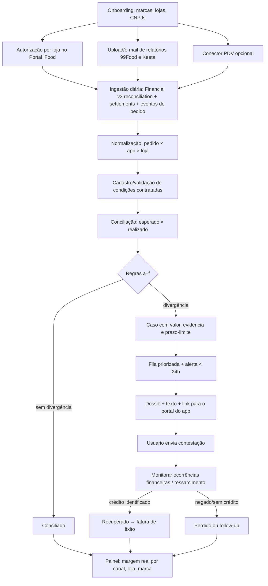
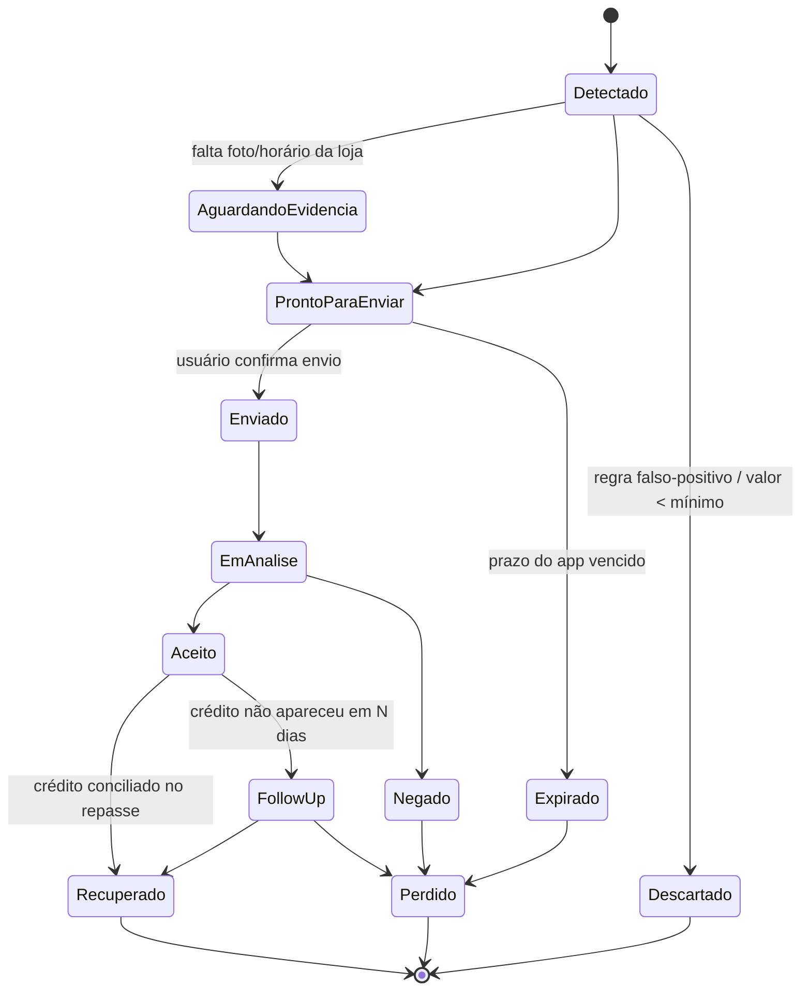
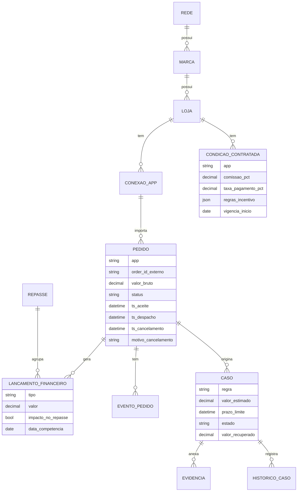

# Ideia 4: conciliação e contestação de delivery (iFood, 99Food, Keeta)

**Execução:** 29/10/2026. Usei o prompt `prompt-detalhamento-e-concorrentes-top4.md`, seções 3 a 7, aplicado só à Ideia 4.

**Legenda das afirmações:**
- ✅ verificado nesta execução, com link;
- 🟡 declarado pela empresa ou por terceiros sem confirmação independente;
- ❓ não verificado.

> **Limitações desta execução (leia antes)**
> 1. **LinkedIn sem login.** Usei buscas `site:linkedin.com/company|posts|in|jobs`, mas o mecanismo de busca **ignorou o operador `site:`** e devolveu notícias e páginas de vagas de outras origens. Portanto, a Parte B se apoia em web aberta, catálogos, imprensa, GitHub e Reclame Aqui. **Nenhuma busca nativa no LinkedIn foi feita.**
> 2. **Leitura direta de páginas bloqueada.** A política de rede desta sessão bloqueou a leitura direta destas páginas: `developer.ifood.com.br`, `blog-parceiros.ifood.com.br`, `99app.com`, `alloy.al`, `chejefe.com` e `ajuda.beefood.com.br`. As informações delas vieram **apenas dos trechos indexados pelo buscador**. Para validar endpoints e regras, libere esses domínios nas configurações de rede do ambiente ([instruções](https://code.claude.com/docs/en/cloud-environments#network-access)) ou consulte as páginas manualmente.

---

## 1. Resumo em 5 linhas

1. **Problema.** Redes de restaurantes perdem dinheiro com:
   - cancelamentos após o preparo;
   - incentivos e cupons descontados do repasse;
   - taxas diferentes das contratadas;
   - repasses atrasados ou faltantes.

   Em 2025–26 isso se agravou com três apps (iFood, 99Food, Keeta) e **janelas de contestação curtas**: 7 dias no iFood ✅ e 72 h na 99Food desde 07/08/2026 ✅.
2. **Cliente.** Redes, franquias e operadores multimarca/dark kitchens com 5 a 100 lojas.
3. **Como funciona.** Conecta a API Financial v3 do iFood (por autorização de cada loja) e os relatórios da 99Food e da Keeta. Concilia pedido a pedido contra as condições contratadas, detecta seis tipos de perda e gera uma fila de contestação com prazo e evidência. Acompanha até o crédito.
4. **Onde está o espaço.**
   - Os apps oferecem contestação **pedido a pedido e manual**, cada um no seu portal.
   - A **F360** já audita taxas de apps para franquias ✅, mas não há evidência de **fila de contestação multi-app com prazos**.
   - Ninguém encontrado cobra por **taxa de êxito**.
5. **Veredito.** Continua **B**, com concorrência mais forte do que se estimava:
   - F360 no topo (franquias);
   - o **iFood dono dos principais PDVs** (Saipos, Opdv, 3S Checkout, Anota AI) ✅.

   A nota cai de **7,1 para 6,6**. Vale validar, mas como **segunda ou terceira opção**, e posicionado abaixo da F360 (redes de 5 a 30 lojas e dark kitchens) ou como parceiro dela.

---

## 2. Parte A: funcionamento e fluxo

### A1. Atores e papéis

| Ator | Papel | Interesse |
|---|---|---|
| **Dono, sócio ou diretor financeiro da rede** | Paga a assinatura e aprova contestações relevantes | Margem real por canal; recuperar perdas |
| **Analista financeiro ou de delivery** (quando existe) | Usuário diário: trata a fila, envia contestações, concilia | Menos planilha; não perder prazo |
| **Gerente de loja** | Fornece evidências (foto do pacote, horário de despacho, código de entrega) | Não ser responsabilizado pelo cancelamento |
| **Franqueadora** | Pode comprar para toda a rede (venda 1 → N lojas) | Padronizar indicadores; reduzir a inadimplência de franqueados |
| **iFood, 99Food, Keeta** (contrapartes) | Calculam repasse, decidem disputas e controlam APIs e portais | Reduzir disputas e cancelamentos; reter dados; o iFood quer ser o "all-in-one" do restaurante ✅ ([Startups](https://startups.com.br/negocios/ifood-compra-tres-startups-para-ser-o-all-in-one-dos-restaurantes/)) |
| **PDV/ERP** (Saipos, Consumer, Teknisa etc.) | Fonte de verdade de vendas, preparo e despacho | Manter a integração; parte deles pertence ao iFood |
| **Contador ou BPO** | Recebe a conciliação mensal | Fechamento correto |

### A2. Anatomia do problema

| Tipo de perda | Exemplo e evidência | Frequência e valor |
|---|---|---|
| **(a) Cancelamento após preparo, com estorno ao restaurante** | Restaurantes relatam que o app "cancela o pagamento para o restaurante" ✅ ([Diário do Nordeste](https://diariodonordeste.verdesmares.com.br/negocios/golpe-no-ifood-deixa-restaurantes-no-prejuizo-app-estuda-cobrar-taxa-de-cancelamento-do-cliente-1.3233691)). Pedido cancelado pelo sistema após a entrega concluída ✅ ([Reclame Aqui](https://www.reclameaqui.com.br/ifood/pedido-cancelado-indevidamente-pelo-sistema-do-ifood-apos-entrega-concluid_Can0R9Xni23rovzD/)). Itens furtados pelo entregador sem reembolso ao restaurante ✅ ([Reclame Aqui](https://www.reclameaqui.com.br/ifood/entregador-furta-itens-de-pedido-ifood-se-recusa-a-reembolsar-restaurante-apos-solicitacao-de-reembolso-ao-cliente_Xb14hriYn45PmW27/)) | Um restaurante relatou queda de cancelamento de 2% para 0,6% com as ferramentas de acordo do iFood 🟡 ([Mundo do Marketing](https://mundodomarketing.com.br/ifood-introduz-ferramentas-de-negociacao-para-reduzir-taxas-de-cancelamento)). **Premissa:** 0,5–2% dos pedidos |
| **(b) Comissão ou taxa acima do contratado** | Comissão de 12% (básico) e 23% (entrega), mais 3,2% de pagamento online, segundo levantamento 🟡 ([A Tarde](https://atarde.com.br/economia/altas-taxas-e-canibalizacao-ifood-e-alvo-de-acusacoes-de-lojistas-1318514)) | ❓ Sem dado de frequência de erro |
| **(c) Incentivo ou promoção descontada indevidamente** | "Descontos indevidos sobre incentivos do iFood" ✅ ([Reclame Aqui](https://www.reclameaqui.com.br/ifood/descontos-indevidos-sobre-incentivos-do-ifood-para-restaurante_a9OkhHtrPSXshdTe/)). Disputa de cupons iFood × Keeta no Cade ✅ ([Economic News](https://economicnewsbrasil.com.br/2026/09/19/cupons-no-delivery-ifood-keeta-cade/)) | ❓ |
| **(d) Pedido entregue e não repassado** | O iFood foi condenado a indenizar uma pamonharia por não repassar vendas ✅ ([Rota Jurídica](https://www.rotajuridica.com.br/?p=79250)). Retenção de R$ 8.074,39 julgada indevida ✅ ([TJRJ](https://portaltj.tjrj.jus.br/documents/d/portal-conhecimento/boletimsedif81)). "Repasses totalmente errados" ✅ ([Reclame Aqui](https://www.reclameaqui.com.br/ifood/repasses-financeiros-totalmente-errados-o-que-o-proprio-ifood-diz-que-tem__yencQAUc46GYD-O/)) | Esporádico, mas de valor alto |
| **(e) Atraso de repasse** | A 99Food atrasou repasses em 2026 e atribuiu o problema a um parceiro financeiro ✅ ([TNH1](https://www.tnh1.com.br/noticia/nid/99food-atrasa-pagamentos-a-restaurantes-parceiros-e-reclamacoes-disparam/)) | Episódico |
| **(f) Item faltante ou reclamação com reembolso indevido** | Reembolso ao cliente debitado do restaurante sem culpa da loja (exemplos acima) | ❓ |
| **(g) Novo, de 2026: venda de salão lançada como venda do app** | A ANR move ação contra o modelo de "compra intermediada" da Keeta, que contabilizaria vendas presenciais como vendas Keeta sem consentimento ✅ ([Forbes](https://forbes.com.br/forbes-money/2026/10/anr-processa-keeta-compra-intermediada-restaurantes/)) | ❓ Piloto |
| **Opacidade geral** | A Senacon abriu processo contra iFood e Keeta por falta de transparência sobre valores retidos e repasses ✅ ([Canaltech](https://canaltech.com.br/mercado/governo-pode-multar-ifood-e-keeta-em-ate-r-14-mi-por-falta-de-transparencia/)) | Estrutural |

**Prazos de contestação (críticos para o produto):**

| App | Prazo | Onde contestar | Fonte |
|---|---|---|---|
| **iFood** | Contestação de cancelamento em até **7 dias** da data do cancelamento; depois disso a função some do Portal | Aba Pedidos, depois "Contestar cancelamento"; acompanhamento em "Ocorrências financeiras" | ✅ trecho do [blog oficial do iFood](https://blog-parceiros.ifood.com.br/contestacao-cancelamento/) e resposta do iFood no Reclame Aqui |
| **iFood** | Prazo de crédito após contestação aceita: **conflitante**. O blog diz até 48 h; o atendimento citou até 30 dias, conforme o modelo de repasse | — | 🟡 |
| **99Food** | Contestação pós-venda em **72 h** após a conclusão do pedido, desde **07/08/2026** (antes eram 7 dias) | Portal do Parceiro > Histórico > Pedidos > Pós-Vendas > "Regras de Contestação" | ✅ trecho do [guia oficial da 99Food](https://99app.com/99food/restaurantes/guias/notificacao-de-alteracao-no-prazo-de-contestacao-pos-venda/) |
| **Keeta** | ❓ Não encontrado | — | — |

**Implicação:** com 72 h na 99Food, a detecção precisa ser **D+0/D+1**, com alerta ativo (WhatsApp ou push). Um relatório mensal não basta.

**Ciclo de repasse do iFood:** fechamento semanal, com pagamento conforme o plano (semanal, quinzenal ou mensal) ✅ ([Saipos](https://saipos.com/ifood/como-funciona-o-repasse-do-ifood)). Um guia de terceiros afirma que o repasse tradicional pode levar até 28 dias após o fechamento 🟡 ([Cardápio Web](https://cardapioweb.com/blog/repasse-do-ifood-guia-para-restaurantes/)).

### A3. Jornada atual (as-is)

1. O gerente de loja vê o cancelamento no tablet do app ou no PDV e, na correria, aceita ou ignora. No iFood, a loja tem poucos minutos para aceitar ou recusar o pedido de cancelamento ✅ ([Saipos](https://saipos.com/noticia/iFood-muda-a-forma-de-cancelamento-de-pedidos)).
2. Ninguém registra evidência (foto, horário de despacho, código de entrega).
3. Uma vez por semana ou por mês, o financeiro da rede baixa o relatório de cada app, **loja a loja**. Na aba Financeiro do Portal do iFood há "Taxas e comissões" ✅ ([Serasa](https://www.serasa.com.br/blog/abrir-loja-no-ifood/)).
4. O financeiro cola os relatórios em planilha e compara com o PDV. A diferença fica em "outros".
5. Quando nota algo, **o prazo já passou** (7 dias no iFood, 72 h na 99Food). Sobra o Reclame Aqui ou o advogado ✅ ([Urbano Ribeiro Advogados](https://urbanoribeiroadvogados.com.br/ifood-cancelou-pedido-sem-repasse-restaurante/)).
6. Resultado: **perda silenciosa**, sem ninguém dedicado. Em redes maiores, um analista gasta horas por semana nisso (❓ quantificar nas entrevistas).

### A4. Fluxo do produto (to-be)

1. **Onboarding (D0).**
   - Cadastrar marcas, lojas e CNPJs.
   - Conectar o iFood: cada loja autoriza o aplicativo no Portal do Parceiro (Aplicativos → autorizar → código de autorização) 🟡 ([fluxo descrito por integrador](https://ajuda.cardapioweb.com/automacao/integracoes/integracao-com-o-ifood)).
   - Conectar a 99Food e a Keeta: upload de relatório (CSV/XLSX) ou leitura do e-mail de extrato.
   - Conectar o PDV (opcional no MVP).
2. **Cadastro das condições contratadas por loja e app:** plano, comissão, taxa de pagamento online, mensalidade, regras de incentivo (quem banca cada cupom) e prazo de repasse. A tela é pré-preenchida com a média observada nos dados e o usuário confirma.
3. **Ingestão diária:**
   - iFood **Financial v3**: endpoint de reconciliação (arquivo CSV mensal comprimido, separador `;`, com campo `impacto_no_repasse`) e endpoint de settlements (repasses, boletos de débito, itens renegociados) 🟡/✅ (trechos da [documentação de reconciliação](https://developer.ifood.com.br/pt-BR/docs/guides/modules/financial/api-reconciliation) e de [settlement](https://developer.ifood.com.br/pt-BR/docs/guides/modules/financial/api-settlement/));
   - eventos de pedido (módulo Order) para status, horários e cancelamentos.
4. **Normalização:** um registro único por pedido × app × loja, com valor bruto, itens, cupom (quem banca), comissão, taxas, status, timestamps (aceite, despacho, entrega, cancelamento), motivo de cancelamento e lançamentos financeiros ligados ao pedido.
5. **Conciliação pedido a pedido:**
   - esperado = bruto − comissão contratada − taxa de pagamento − incentivos de responsabilidade da loja;
   - realizado = soma dos lançamentos com impacto no repasse;
   - Δ = realizado − esperado.
6. **Detecção.** Seis regras, (a) a (f), detalhadas na seção A6, mais uma (g) opcional de "venda intermediada". Cada achado vira um **caso** com valor, regra, evidência e **prazo-limite** (data do evento + 7 dias no iFood; + 72 h na 99Food).
7. **Priorização e alerta:** fila ordenada por (valor × probabilidade de êxito) ÷ tempo restante. Alerta no WhatsApp ou e-mail do responsável quando faltam menos de 24 h.
8. **Contestação:** o produto monta o dossiê (linha do tempo do pedido, código de entrega, foto, horário de despacho, cláusula ou condição contratada) e o texto pronto. O envio é feito pelo usuário no portal do app, com link direto e passo a passo. A API de contestação ❓ não foi confirmada.
9. **Acompanhamento até o crédito:** o produto lê "Ocorrências financeiras" e os lançamentos de ressarcimento no arquivo de reconciliação para marcar o caso como *recuperado*. Se não houver crédito em N dias, gera um caso de follow-up.
10. **Painel:** margem real por loja, app e marca; perdas detectadas, contestadas e recuperadas; ranking de lojas por taxa de cancelamento; relatório mensal para o contador. Na cobrança por êxito, a fatura sai sobre o valor efetivamente recuperado.

**Fluxo principal**

**Estados de um caso**

### A5. Fontes de dados e integrações

| Fonte | Formato | Autenticação | Disponibilidade pública | Limites conhecidos | Plano B |
|---|---|---|---|---|---|
| **iFood Financial v3**: `/merchants/{merchantId}/reconciliation` e `/merchants/{merchantId}/settlements` | API REST; reconciliação em CSV comprimido mensal com link expirável | OAuth/token de aplicativo; cada loja autoriza no Portal do Parceiro | Documentada no [portal do desenvolvedor](https://developer.ifood.com.br/pt-BR/docs/guides/modules/financial/api-reconciliation) ✅ (via trechos indexados) | Arquivo **mensal**, o que pode não servir para a janela de 7 dias: confirmar se o arquivo do mês corrente é atualizado diariamente ❓. A V3 tem arquivo de homologação 🟡. **Requisitos de homologação e de contrato de parceiro: ❓** | Exportação manual do Portal (aba Financeiro) |
| **iFood Order/Events** | API REST + polling de eventos | Mesmo token | Documentada ✅ (módulo citado) | Precisa de homologação; categorias podem ter restrições 🟡 (relato de 2022 sobre mercado/pet) | Dados do PDV |
| **99Food** | ❓ API pública não encontrada. Aderiu ao **Open Delivery** (padrão Abrasel de pedidos) ✅ ([ABC da Comunicação](https://www.abcdacomunicacao.com.br/99food-e-keeta-concluem-integracao-ao-open-delivery/)) | — | O Open Delivery é open source ([docs Abrasel via Cardápio Web](https://ajuda.cardapioweb.com/automacao/integracoes/open-delivery)) ✅. **Módulo financeiro no padrão: ❓** | Integrações existentes passam por PDVs (Saipos, Consumer, Teknisa, Cardápio Web) ✅ | Upload de relatório do portal + leitura de e-mail |
| **Keeta** | ❓ API pública não encontrada. Aderiu ao Open Delivery ✅. Vagas de "API Integration" indicam API para PDVs e grandes redes ✅ ([vaga](https://expertini.work/result/work-keeta-api-product-operations-sao-paulo-sp-keeta-5062-920980-brazil/)) | — | Integração via Teknisa por link de autorização ✅ ([guia Teknisa](https://universidade.teknisa.com/wp-content/uploads/2026/04/RETAIL_GUIA_DE_SOLICITACAO_INTEGRACAO_TEKNISA_KEETA_GUINTKETV1.pdf)) | ❓ | Upload de relatório |
| **PDV** (Saipos, Consumer, Teknisa, Cardápio Web etc.) | APIs próprias. A Saipos anuncia API pública ✅ ([Saipos](https://saipos.com/integracoes)) | Por PDV | Variável | **Saipos, Opdv, 3S Checkout e Anota AI pertencem ao iFood desde abril/2025** ✅ ([Bloomberg Línea](https://www.bloomberglinea.com.br/negocios/ifood-adquire-tres-empresas-de-gestao-e-avanca-pelo-salao-dos-restaurantes/)), o que traz risco de política de acesso | Exportação CSV do PDV |
| **Evidências da loja** | Fotos e horários | App/PWA próprio ou WhatsApp | — | Disciplina da loja | Registro só em casos de valor alto |

**Sem integração fechada no MVP:** é possível operar 100% com **exportações dos portais + e-mail + 1 conector iFood** (API documentada). Como a 99Food e a Keeta podem não ter API financeira, o MVP deve aceitar uploads desde o primeiro dia.

### A6. Regras de negócio e motor de decisão (determinístico primeiro)

| Regra | Lógica | Entrada → saída (exemplo) |
|---|---|---|
| **(a) Cancelamento pós-preparo com estorno à loja** | status = cancelado E houve aceite + despacho (ou preparo > X min) E lançamento negativo ou ausência de repasse para a loja E motivo ≠ "loja" | Pedido R$ 82, cancelado após despacho, motivo "cliente não encontrado", repasse R$ 0 → caso de R$ 82 × (1 − comissão), prazo D+7 |
| **(b) Comissão ou taxa acima do contrato** | taxa efetiva do pedido > taxa contratada + tolerância (0,1 p.p.) | Comissão contratada de 12%, cobrada 23% → caso de R$ 9,02 |
| **(c) Incentivo indevido** | cupom marcado "bancado pelo app" no cadastro E lançamento de incentivo debitado da loja | Cupom de R$ 10 de campanha do app debitado → caso de R$ 10 |
| **(d) Entregue e não repassado** | status = concluído E sem lançamento com `impacto_no_repasse` após o fechamento + N dias | Caso pelo valor líquido esperado |
| **(e) Atraso de repasse** | data esperada (pelo plano) < hoje E repasse não recebido ou menor que o esperado | Alerta financeiro (não é contestação; vira cobrança no suporte) |
| **(f) Reembolso indevido por item faltante** | reembolso ao cliente E loja tem evidência de item embalado (foto/checklist) | Caso com evidência obrigatória |
| **(g) Venda intermediada (Keeta)** | lançamento de venda Keeta sem pedido correspondente no PDV | Alerta para auditoria |
| **Supressão** | valor < R$ 5 (configurável), loja aceitou cancelamento explicitamente, reembolso automático já creditado | Descarta |

**Onde a IA é realmente necessária:**
1. **Ler relatórios heterogêneos** (99Food e Keeta em PDF/XLSX sem layout fixo): um LLM extrai os dados para um schema validado por regras.
2. **Redigir o texto de contestação** a partir do template + evidência.
3. **Classificar motivos de cancelamento em texto livre.**

Conciliação, cálculo de esperado × realizado e prazos são **100% determinísticos**.

### A7. Modelo de dados mínimo

### A8. Telas do MVP (no máximo 6)

| Tela | Objetivo | Dado principal |
|---|---|---|
| 1. **Conexões** | Conectar lojas no iFood e subir relatórios da 99Food e da Keeta | Status de cada loja × app; última sincronização |
| 2. **Condições contratadas** | Confirmar plano, comissão e incentivos por loja e app | Taxa observada × taxa contratada |
| 3. **Fila de casos** | Trabalhar o dia | **R$ em risco que vence em < 24 h** |
| 4. **Detalhe do caso / dossiê** | Copiar texto, baixar PDF, abrir o portal do app, marcar como enviado | Linha do tempo do pedido + evidência |
| 5. **Painel da rede** | Margem real por canal, loja e marca | R$ perdido, contestado e recuperado no mês |
| 6. **Relatório mensal / fatura** | Fechamento e cobrança de êxito | Valor recuperado e taxa devida |

### A9. Casos de borda e riscos

- **Técnicos:**
  - o arquivo de reconciliação do iFood é **mensal**; se não for atualizado diariamente, a regra (a) perde a janela de 7 dias. Mitigação: usar eventos de pedido (Order) para detecção D+0 e o Financial apenas para confirmação ❓;
  - mudanças de layout dos relatórios da 99Food e da Keeta;
  - limites de API;
  - lojas com vários CNPJs.
- **Plataforma (o maior risco):**
  - o iFood é dono de Saipos, Opdv, 3S Checkout e Anota AI ✅ e tem incentivo para **não** facilitar auditoria de terceiros. Também pode lançar uma versão nativa (já tem "Ocorrências financeiras", aba "Reembolsos" e o Meu Caixa do iFood Pago, que mostra taxas descontadas ✅ ([Mercado & Consumo](https://mercadoeconsumo.com.br/15/11/2024/destaque-do-dia/ifood-pago-apresenta-solucao-para-organizacao-de-fluxo-de-caixa-dos-restaurantes/)));
  - a homologação do módulo Financial para um "auditor" independente não foi verificada ❓.
- **Jurídicos:**
  - termos de uso dos apps sobre ferramentas de terceiros ❓;
  - **evitar RPA nos portais** (risco de bloqueio da conta); preferir API oficial e upload;
  - LGPD: dados de consumidores finais nos pedidos, com minimização (guardar apenas IDs e valores);
  - contestação administrativa não exige advogado; ações judiciais ficam fora do escopo, mas podem virar parceria com escritórios ✅ ([exemplo](https://urbanoribeiroadvogados.com.br/ifood-cancelou-pedido-sem-repasse-restaurante/)).
- **Operacionais:** sem evidência da loja, a taxa de êxito cai. É preciso um mini-checklist no despacho (foto do pacote lacrado, por exemplo).
- **Comerciais:**
  - redes pequenas podem achar o valor recuperado baixo;
  - redes grandes já têm F360, Simetrik ou analista interno;
  - medo de "brigar" com o iFood. Resposta: a contestação é **um recurso oficial do próprio app**.

### A10. Escopo do MVP (30–60 dias) e métricas

- **Entra:**
  - conector iFood (Financial v3 + eventos de pedido);
  - upload de CSV/XLSX da 99Food e da Keeta;
  - cadastro de condições;
  - regras (a), (b), (c) e (d);
  - fila com prazo e alerta por WhatsApp/e-mail;
  - dossiê em PDF com texto pronto;
  - marcação manual de "enviado" e "recuperado";
  - painel simples.
- **Fica fora:** envio automático de contestação, regras (e), (f) e (g), app de evidência para a loja, integração com PDV, faturamento automático.
- **Métrica de valor primária:** **R$ recuperado por loja por mês**, e a razão R$ recuperado ÷ preço (meta ≥ 3×).
- **Métricas de uso:** % de casos tratados antes do prazo, casos/semana, tempo médio de tratamento e login semanal do analista.
- **Sucesso do piloto (60 dias):** em ≥ 2 de 3 redes, recuperado ≥ 3× o preço OU perda detectada ≥ 1% do faturamento de delivery, e a rede aceita pagar R$ 99/loja/mês ou 20% de êxito.

---

## 3. Parte B: concorrentes no Brasil

### B1. Log de buscas executadas

| # | Consulta (resumo) | Resultado |
|---|---|---|
| 1 | iFood Financial API: conciliação, repasses, endpoints | ✅ Docs de reconciliação e settlement (via trechos); blog sobre a V3 |
| 2 | Contestação no Portal do Parceiro iFood: prazo | ✅ 7 dias (blog oficial via trecho; Reclame Aqui) |
| 3 | 99Food: API, integradores, Open Delivery | ✅ Open Delivery; integrações via Saipos, Consumer, Teknisa e Cardápio Web; **sem API pública** |
| 4 | 99Food: prazo de contestação de 72 h | ✅ 72 h desde 07/08/2026 |
| 5 | Keeta: API e integração com PDVs | ✅ Teknisa, Deliverect (global); vagas de API; **sem doc pública** |
| 6 | Keeta: contestação e reembolso do lojista | Vazio para prazos; ✅ ação da ANR sobre compra intermediada |
| 7 | Open Delivery: módulos e financeiro | Vazio para o financeiro; ✅ doc Abrasel open source |
| 8 | Homologação do iFood para software house / módulo Financial | Vazio para os requisitos; 🟡 fluxo de autorização por loja |
| 9 | "conciliação iFood" + startup, redes, franquias, recuperar valores | ✅ BeeFood, Cardápio Web (conteúdo), Jefe (conteúdo), Alloy (conteúdo) |
| 10 | Alloy | ✅ Plataforma de gestão e automação (RS, 2020); conciliação ❓ |
| 11 | Jefe / chejefe | Vazio sobre o produto |
| 12 | BeeFood | ✅ SaaS de gestão para restaurantes (Sorocaba); conciliação de taxas e incentivos iFood 🟡 (trecho da central de ajuda) |
| 13 | "Crescer com Delivery" (repositório no GitHub preparando homologação do Financial) | Vazio sobre a empresa |
| 14 | `site:linkedin.com/company` conciliação delivery iFood | **Operador ignorado**; ✅ aquisições do iFood (Saipos, Opdv, 3S, Anota AI) |
| 15 | `site:linkedin.com/posts` conciliação iFood, cancelamentos | **Operador ignorado**; ✅ ferramentas de acordo do iFood |
| 16 | `site:linkedin.com/in` fundador conciliação delivery | **Operador ignorado**; sem fundadores relevantes |
| 17 | `site:linkedin.com/jobs` analista conciliação delivery | **Operador ignorado**; ✅ vagas de conciliação **no próprio iFood** (Greenhouse) |
| 18 | Datas das aquisições Saipos, Opdv, 3S Checkout | ✅ 30/04/2025 |
| 19 | F360: conciliação de apps de delivery para franquias | ✅ **Auditoria de taxas de apps e conciliação**; caso Polachini (KFC/Bob's): R$ 37 mil recuperados |
| 20 | F360: auditoria, preço | ✅ Escopo; preço ❓; projeção de R$ 46 milhões de faturamento em 2026 🟡 |
| 21 | Equals / Concil + iFood | Vazio |
| 22 | Consumer: conciliação iFood | Vazio para conciliação; ✅ integração 99Food |
| 23 | Otter / Hubster / Deliverect no Brasil | ✅ Deliverect integra Keeta (global); iFood BR ❓ |
| 24 | Nola (BI de redes) | Vazio |
| 25 | Auditoria de repasse iFood por taxa de êxito | Vazio para fornecedores; ✅ escritório de advocacia; ✅ modelo de êxito em créditos tributários (outro tema) |
| 26 | Saipos: conciliação iFood | ✅ controle financeiro genérico; sem conciliação de divergências |
| 27 | Omie / Conta Azul + iFood | ✅ Omie (pedidos + conciliação bancária consolidando apps); Conta Azul só via Albato |
| 28 | Teknisa / Linx Degust / 3S Checkout: conciliação | Vazio |
| 29 | ifood-api simplexo | Vazio; ✅ pacotes open source de integração (Laravel) e servidor MCP não oficial |
| 30 | Contestação iFood: ocorrências financeiras e reembolso | ✅ fluxo nativo detalhado |

### B2. Fichas dos concorrentes

**1. iFood: recursos nativos (Portal do Parceiro e iFood Pago)** · substituto principal

| Campo | Conteúdo |
|---|---|
| Links | [Blog de parceiros: contestação](https://blog-parceiros.ifood.com.br/contestacao-cancelamento/) · [Blog: conciliação financeira](https://blog-parceiros.ifood.com.br/conciliacao-financeira/) · [Meu Caixa / iFood Pago](https://mercadoeconsumo.com.br/15/11/2024/destaque-do-dia/ifood-pago-apresenta-solucao-para-organizacao-de-fluxo-de-caixa-dos-restaurantes/) |
| Tipo | Recurso nativo da contraparte |
| Funcionalidades confirmadas | Contestação de cancelamento por pedido em até 7 dias ✅; "Ocorrências financeiras" e aba "Reembolsos" ✅; detalhe de taxas e comissões na aba Financeiro ✅; o Meu Caixa mostra bandeiras e taxas descontadas ✅; ferramentas de acordo com o cliente (reembolso parcial) ✅ ([Mercado & Consumo](https://mercadoeconsumo.com.br/10/06/2024/foodservice/ifood-cria-novas-ferramentas-de-acordo-entre-clientes-e-restaurantes/)) |
| Etapas cobertas (A4) | 3 ◐, 5 ◐ (manual, pedido a pedido), 6 ◐ |
| Não resolve | Multi-app; verificação contra a condição contratada; fila priorizada por prazo; visão de rede; neutralidade |
| Confiança | Alta |

**2. F360** · concorrente mais próximo no segmento de franquias

| Campo | Conteúdo |
|---|---|
| Links | [Portal do Franchising](https://www.portaldofranchising.com.br/noticias/franquias-de-alimentacao-tem-apoio-da-f360/) · [Baguete: Grupo Polachini](https://www.baguete.com.br/noticias/grupo-polachini-gere-financas-com-f360) · [Portal ERP: crescimento](https://portalerp.com/br/noticia/f360-cresce-32-e-projeta-faturar-r-46-milhoes-em-2026-com-ia-e-novas-solucoes) · LinkedIn ❓ (não acessado) |
| Tipo | SaaS de gestão financeira para varejo multiunidade e franquias |
| Funcionalidades confirmadas | "Automatizou o processo de conciliação [de vouchers e apps de entrega] e forneceu uma auditoria das taxas praticadas, garantindo repasses adequados e identificando valores devidos" ✅ (imprensa); conciliação de cartões, fluxo de caixa, DRE e visão multi-loja ✅ |
| Tração | Polachini (KFC/Bob's): R$ 37 mil recuperados em 6 meses e 95% das conciliações automatizadas 🟡; projeção de R$ 46 milhões de faturamento em 2026 e crescimento de 32% 🟡 |
| Etapas cobertas | 1 ◐, 3 ✅🟡, 4 ◐ (taxas), 7 ✅ |
| Não resolve (aparentemente) | Fila de contestação com **prazo por app** ❓; regras de cancelamento pós-preparo ❓; incentivos ❓; cobrança por êxito ❌ |
| Preço | ❓ |
| Confiança | Média: a evidência vem de imprensa e não da documentação do produto |

**3. Simetrik** · enterprise

| Campo | Conteúdo |
|---|---|
| Links | [Case iFood (PT)](https://simetrik.com/wp-content/uploads/2026/08/iFood-Success-case-PT.pdf) |
| Tipo | Plataforma de conciliação no-code (enterprise, LatAm) |
| Funcionalidades | Conciliação transação a transação com dados na origem e detecção precoce de discrepâncias ✅ (para o próprio iFood) |
| Etapas cobertas | 3 ✅, 4 ◐ (genérico), 7 ◐ |
| Não resolve | Não é produto para restaurantes; sem contestação; ticket enterprise 🟡 |
| Confiança | Alta (o case existe); baixa como ameaça direta no segmento-alvo |

**4. Saipos (iFood desde 04/2025)** · PDV

| Campo | Conteúdo |
|---|---|
| Links | [saipos.com](https://saipos.com) · [integrações](https://saipos.com/integracoes) · [aquisição](https://www.bloomberglinea.com.br/negocios/ifood-adquire-tres-empresas-de-gestao-e-avanca-pelo-salao-dos-restaurantes/) |
| Funcionalidades | Pedidos de iFood, 99Food e outros no PDV ✅; "controle financeiro dos pedidos de entrega" genérico ✅; conteúdo educativo sobre repasse e reembolso ✅; API pública ✅ |
| Etapas cobertas | 1 ✅ (pedidos), 3 ◐, 7 ◐ |
| Não resolve | Detecção de divergência contra o contrato e contestação (nenhuma evidência). Tem conflito de interesse por pertencer ao iFood |
| Confiança | Média |

**5. BeeFood** · PDV/SaaS

| Campo | Conteúdo |
|---|---|
| Links | [Central de ajuda (trecho)](https://ajuda.beefood.com.br/baseconhecimento/como-funciona-o-incentivo-ifood-e-conciliacao-automatica-dos-pagamentos/) · [PitchBook](https://pitchbook.com/profiles/company/545781-79) |
| Tipo | SaaS de gestão para restaurantes (Sorocaba) |
| Funcionalidades | Conciliação automática de taxas e incentivos do iFood um dia após cada pedido (pedidos desde 01/09/2023) 🟡 |
| Etapas cobertas | 3 ◐, 4 ◐ (c) |
| Não resolve | Multi-app ❓; contestação ❓; foco em restaurante único 🟡 |
| Confiança | Baixa (a página não pôde ser lida por inteiro) |

**6. Omie** · ERP

| Campo | Conteúdo |
|---|---|
| Links | [Blog: iFood + ERP](https://www.omie.com.br/blog/como-integrar-o-ifood-ao-sistema-erp-do-seu-restaurante/) · [Ajuda: PDV Restaurante + iFood](https://ajuda.omie.com.br/pt-BR/articles/9539266-omie-pdv-restaurante-integrando-com-o-ifood) |
| Funcionalidades | Pedidos do iFood no PDV ✅; conciliação bancária consolidando vendas de apps 🟡; "registra as taxas cobradas pelas plataformas" 🟡 |
| Etapas cobertas | 1 ◐, 3 ◐ |
| Não resolve | Contestação; condição contratada; prazo |
| Confiança | Média |

**7. Reportei** · relatórios de marketing

| Campo | Conteúdo |
|---|---|
| Links | [Integração iFood](https://reportei.com/integracao-ifood-e-reportei/) |
| Funcionalidades | Usa a API oficial do iFood; métricas e dados financeiros com ciclo semanal ✅ |
| Etapas cobertas | 1 ◐ (só iFood), 7 ◐ |
| Não resolve | Conciliação, detecção e contestação |
| Confiança | Alta |

**8. Conta Azul (via Albato)**: envia pedidos do iFood ao ERP ✅ ([Albato](https://albato.com/integration-contaazul-ifood)). Não concilia taxas. Ameaça baixa.

**9. Alloy** · gestão e automação para restaurantes (RS, 2020) ✅ ([Sicredi](https://www.sicredi.com.br/coop/norte-sc/noticias/produtos/associados-sicredi-tem-acesso-beneficio-exclusivo-com-alloy-para-impulsionar-negocios-alimentacao/), [Descubre](https://www.descubre.vc/foodtech-alloy)). Publica conteúdo sobre repasse do iFood ([blog](https://www.alloy.al/post/repasse-ifood)). Conciliação ou contestação ❓. Confiança baixa.

**10. Cardápio Web** · cardápio, PDV e integrações (iFood, 99Food, Open Delivery) ✅ ([ajuda](https://ajuda.cardapioweb.com/automacao/integracoes/99food)). Publica guia de repasse ✅. Conciliação ❓.

**11. Escritórios de advocacia e consultorias de delivery** · substitutos. Exemplo: Urbano Ribeiro Advogados orienta a cobrança de cancelamentos ✅. Há consultorias de delivery com reclamações ✅ ([Reclame Aqui](https://www.reclameaqui.com.br/delivery-campeao-e-gestao/cobranca-indevida-e-falta-de-suporte-apos-perda-de-acesso-ao-ifood_qSNW6xzVdTrYXXP3/)). Fazem trabalho manual e caro; possível **canal de parceria** para casos grandes.

**12. Soluções caseiras** · repositórios no GitHub integrando o Financial do iFood (por exemplo, [Central-Crescer-Com-Delivery: "preparar Financial para homologação"](https://github.com/trabalhosgestornocode-hash/Central-Crescer-Com-Delivery/pull/16) e [Sistema-Pet: "Financial iFood com repasses e CMV"](https://github.com/lcsgmoraes-droid/Sistema-Pet/pull/1552)) ✅. É sinal de demanda e mostra que a barreira técnica é baixa: **a diferenciação não pode ser só "ter o conector"**.

**Não verificados (precisam de busca dedicada ou de LinkedIn logado):** Equals, Concil, Consumer (módulo financeiro), Teknisa, Linx Degust, 3S Checkout, Goomer, Menew, Jefe, Nola, Otter/Hubster no Brasil.

### B3. Matriz de sobreposição funcional

Etapas: **1** conexão multi-app · **2** condições contratadas · **3** conciliação pedido a pedido · **4** detecção (a–f) · **5** fila de contestação com prazo · **6** acompanhamento até o crédito · **7** painel rede/app/marca · **8** cobrança por êxito.

| Concorrente | 1 | 2 | 3 | 4 | 5 | 6 | 7 | 8 |
|---|:-:|:-:|:-:|:-:|:-:|:-:|:-:|:-:|
| iFood (nativo) | ❌ | ◐ | ◐ | ◐ | ◐ | ◐ | ❌ | ❌ |
| 99Food (nativo) | ❌ | ❓ | ◐ | ❓ | ◐ | ❓ | ❌ | ❌ |
| F360 | ◐ | ❓ | ✅🟡 | ◐ | ❓ | ❓ | ✅ | ❌ |
| Simetrik | ◐ | ❓ | ✅ | ◐ | ❌ | ❓ | ◐ | ❌ |
| Saipos | ✅ | ❌ | ◐ | ❌ | ❌ | ❌ | ◐ | ❌ |
| BeeFood | ❓ | ❓ | ◐ | ◐ | ❓ | ❓ | ❓ | ❌ |
| Omie | ◐ | ❌ | ◐ | ❌ | ❌ | ❌ | ◐ | ❌ |
| Reportei | ◐ | ❌ | ❌ | ❌ | ❌ | ❌ | ◐ | ❌ |
| Advogados e consultorias | ❌ | ❌ | ❌ | ◐ | ◐ | ◐ | ❌ | ✅ |
| **Proposta** | ✅ | ✅ | ✅ | ✅ | ✅ | ✅ | ✅ | ✅ |

**Etapas onde ninguém tem ✅:**
- **2** (condições contratadas como base de auditoria);
- **5** (fila multi-app com prazo-limite e alerta);
- **6** (confirmação automática do crédito);
- **8** (êxito sobre o recuperado), com exceção dos serviços jurídicos.

O espaço do produto está na **operação de contestação**, não na conciliação, onde F360, Simetrik e os PDVs já atuam.

### B4. Reclassificação

- **Categoria: B (concorrência parcial). Confiança média.**
- **Ameaças:**
  1. **F360**, no segmento de franquias com mais de 20 lojas: já audita taxas de apps e tem caso público de recuperação.
  2. **O próprio iFood**, dono dos principais PDVs ✅, que já oferece contestação nativa, Meu Caixa e conciliação. Pode fechar a lacuna ou restringir o acesso de auditores.
  3. Conectores caseiros e PDVs regionais, porque a barreira técnica é baixa.
- **Risco de a contraparte resolver nativamente:** **alto** no iFood e médio na 99Food e na Keeta.
- **Ajuste de nota:** concorrência de 7 para 6; aquisição de 7 para 6,5; o risco de plataforma sobe. **Nota final: 6,6** (antes 7,1).
- **Ainda não verificado:**
  - requisitos de homologação do módulo Financial para terceiros;
  - se o arquivo de reconciliação é atualizado diariamente;
  - APIs financeiras da 99Food e da Keeta;
  - prazo de contestação da Keeta;
  - funcionalidades reais de contestação da F360;
  - Equals, Concil, Teknisa, Consumer, Linx e Goomer;
  - presença no LinkedIn (startups pequenas não indexadas).

---

## 4. Riscos principais e perguntas para entrevistas

**Riscos principais:**
1. Dependência do iFood: API, homologação e conflito com os PDVs que ele possui.
2. Janelas de 7 dias e 72 h exigem disciplina diária do cliente.
3. O valor recuperado por loja pode ser pequeno, o que derruba o preço sustentável.
4. A F360 pode adicionar uma fila de contestação.

**10 perguntas (foco em dinheiro e disposição a pagar):**
1. Nos últimos 30 dias, quantos pedidos foram cancelados **depois** de preparados, por loja e por app? Você tem esse número ou precisa estimar?
2. Desses, quantos você contestou? Quantos o app devolveu? Quanto, em R$?
3. Quem confere hoje o repasse de cada app, com que frequência, e quantas horas por semana leva?
4. Você sabe a comissão e as taxas contratadas por loja em cada app? Onde isso está registrado?
5. Já identificou cupom ou incentivo debitado que deveria ser pago pelo app? De quanto foi o último caso?
6. Já perdeu um prazo de contestação (7 dias no iFood, 72 h na 99Food)? O que aconteceu?
7. Usa F360, Simetrik, um ERP ou um analista para conciliar delivery? O que essa solução **não** faz?
8. Se eu mostrasse, no mês passado, R$ X recuperável nas suas lojas, você pagaria R$ 99 por loja por mês ou 20% do recuperado? Qual dos dois prefere, e por quê?
9. Quem aprova esse tipo de contratação? Franqueadora ou franqueado?
10. Você me passaria a exportação financeira de 1 mês de 2 lojas para um diagnóstico gratuito esta semana? *(Teste de compromisso real.)*

---

## 5. Nota comparativa (parcial)

O capítulo comparativo do prompt exige as 4 ideias, e esta execução cobriu **apenas a Ideia 4**. A conclusão provisória: a Ideia 4 **cai de 4ª para 5ª posição** (nota 6,6, abaixo da ILPI, com 7,0) por causa de dois fatores:
- a sobreposição com a F360 no segmento de franquias;
- a integração vertical do iFood (Saipos, Opdv, 3S Checkout, Anota AI).

O componente reaproveitável entre as ideias **evidência → dossiê → prazo → acompanhamento → cobrança por êxito** se confirma aqui: é o mesmo motor das Ideias 1 (deduções) e 2 (marketplaces).

**Se for validar a Ideia 4,** o experimento recomendado é: **diagnóstico gratuito de 1 mês para 10 redes de 5 a 30 lojas** que não usem F360, com meta de ≥ 1% do GMV de delivery em perdas detectáveis e 3 pilotos pagos.
